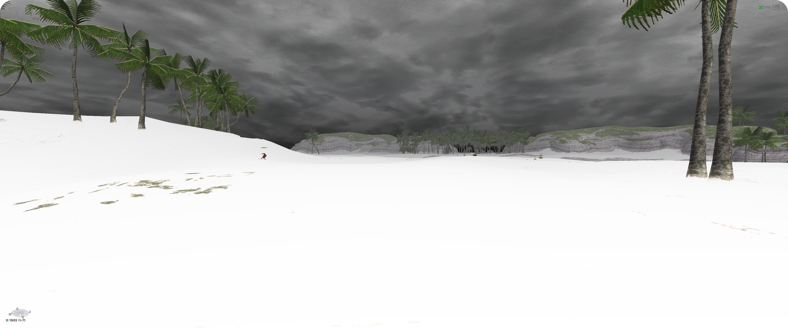
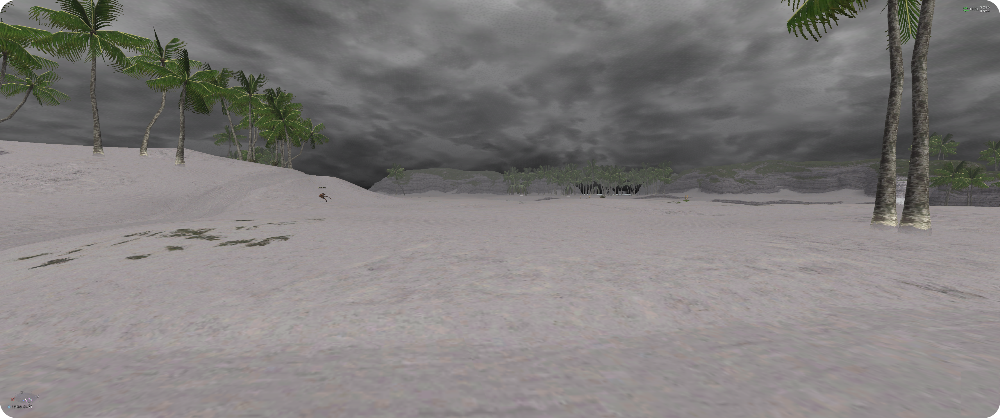

# dim

*by sbn · Ashita v4*

Reduces daylight glare in **Valkurm Dunes**, keeping the terrain's detail and the rest of the screen clear.

[Download dim.zip](https://github.com/1-sbn/dim/releases/latest/download/dim.zip)

## Install

1. Extract `dim.zip` into your `addons` folder.
2. Load the addon:

   ```text
   /addon load dim
   ```

To load automatically, add that command to your startup script.

## Commands

| Command | Action |
| --- | --- |
| `/dim` | Toggle on or off |
| `/dim on` | Enable automatic operation |
| `/dim off` | Disable |

## Schedule

Uses **in-game time** and applies only in Valkurm Dunes.

| Time | Glare reduction |
| --- | ---: |
| 06:00 | 10% |
| 07:00 | 20% |
| 08:00 | 30% |
| 09:00 | 40% |
| 10:00–13:59 | 50% |
| 14:00 | 30% |
| 15:00 | 20% |
| 16:00 | 10% |
| 17:00–05:59 | Off |

The effect returns automatically each day. Other zones stay unchanged.

> Custom texture packs may not match the included materials.

## Before



## After


